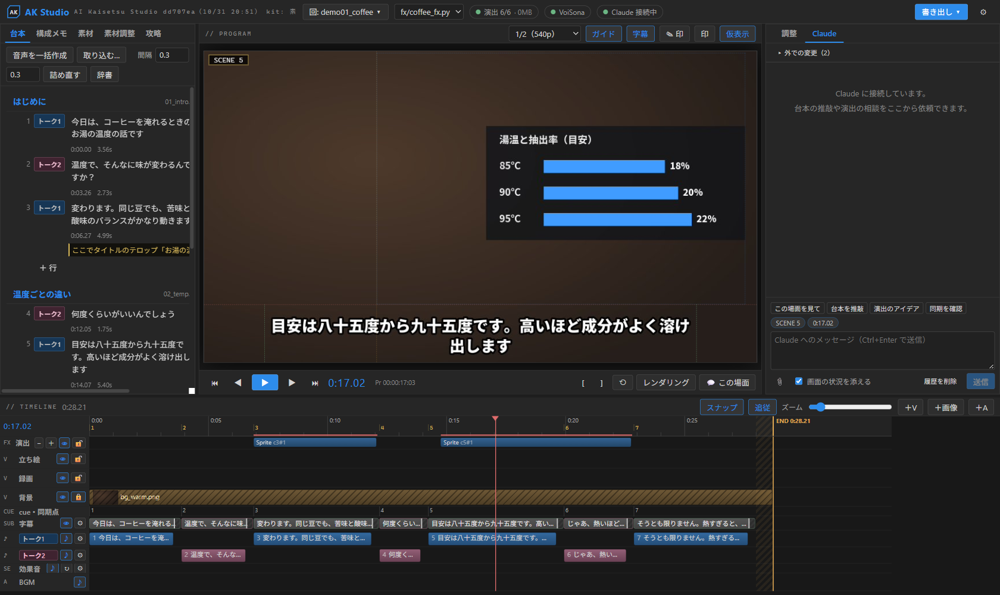
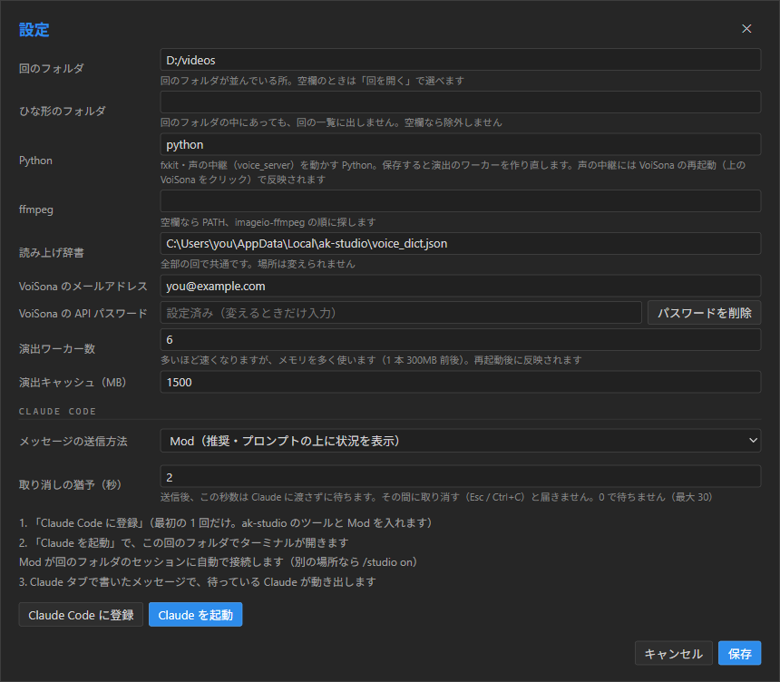
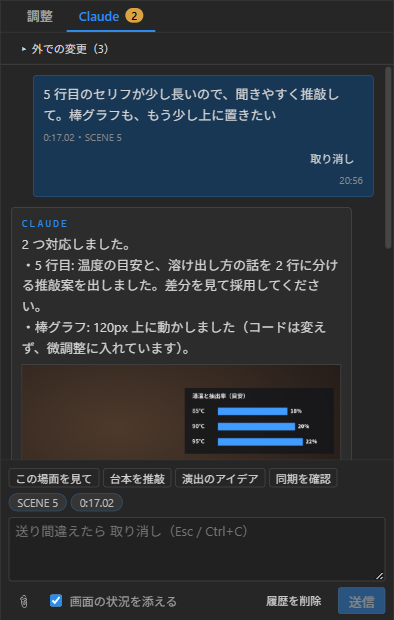
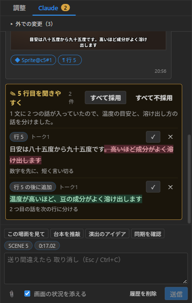

# AK Studio

[](https://github.com/holmesfems/ai-kaisetsu-studio/actions/workflows/ci.yml)

AK Studio（AI Kaisetsu Studio）は、解説動画のための編集アプリ。台本・声・演出・合成をひとつにまとめ、
Claude と一緒に作る。Premiere Pro のように「モニター＋タイムライン」で見ながら、

- 台本を書く（2 人の掛け合いなど。行ごとにメモを付けられる）
- 声のエンジン（VoiSona Talk・VOICEVOX。自作のエンジンも足せる）で声を作る（読みの辞書つき。VoiSona Talk ならアクセントの手直しも）
- Python で書いた演出（テロップ・表・図解・録画の窓）を、コードを書き換えずに手で微調整する
- 背景・録画・立ち絵・演出・字幕・声・効果音・BGM を合成して mp4 に書き出す

編集中は Claude Code とつながり、画面のチャットから台本の推敲や演出の直しを頼める。



<sub>見本の回（コーヒーの淹れ方を 2 人で話す 30 秒の動画）。演出の kit なし・プリセットなしの公開版のまま。棒グラフとタイトルは回の `fx/coffee_fx.py` に Python で書いたもの。</sub>

- アプリ本体: Tauri v2（Rust）＋ React。合成・キャッシュ・再生・書き出しは Rust
- 演出: 各回の `fx/<名前>_fx.py`（fxkit）を読み込んで描く。Python のワーカーを並列で常駐させる
- 声: `voice/voice_server.py`（声の中継）を裏で動かし、選んだ声のエンジンで作る（[docs/voice-engine.md](docs/voice-engine.md)）
- Claude: MCP サーバー（`ak-studio-mcp.exe`）と Claude Code の Mod（`claude-plugin/ak-studio`）

## 要るもの

- Windows 10 / 11（WebView2 は Windows 11 には入っている）
- [Rust](https://rustup.rs/)（MSVC）と [Node.js](https://nodejs.org/)
- Python 3.10 以上（演出のワーカーが使う。`pillow numpy scipy fonttools imageio-ffmpeg`）
- 声のエンジン（声を作るとき。どちらか）: [VoiSona Talk](https://voisona.com/)（環境設定で API をオンにする）か [VOICEVOX](https://voicevox.hiroshiba.jp/)（起動しておくだけ）。自作のエンジンも使える（[docs/voice-engine.md](docs/voice-engine.md)）
- [Claude Code](https://claude.com/claude-code)（Claude とつなぐとき）

## 入れ方・起動

```
git clone https://github.com/holmesfems/ai-kaisetsu-studio
cd ai-kaisetsu-studio
npm install
python -m pip install -e fxkit --config-settings editable_mode=compat   # 演出のエンジン（初回だけ）
npm run tauri build -- --no-bundle
target\release\ak-studio.exe
```

開発中は `npm run tauri dev`（画面はホットリロード、Rust は保存で作り直し）。
MCP サーバーは `cargo build --release -p ak-studio-mcp`。テストは `npm run test:all`。
開発の手引きは [CLAUDE.md](CLAUDE.md)、構成は [docs/architecture.md](docs/architecture.md)。

## 初めての設定

右上の ⚙ で設定を開く。最初に見るのは次の 4 つ。ほかは既定のままでよい。



| 項目 | 入れるもの |
|---|---|
| 回のフォルダ | 動画 1 本ぶんのフォルダ（「回」）を並べて置く所（例 `D:/videos`）。「回を開く」の一覧がここから出る。空欄でも、「回を開く」でフォルダを直接選べる |
| Python | 演出のワーカーと声の中継を動かす Python。上の `pip install` をした Python を指す（PATH の `python` で足りれば `python` のまま） |
| ffmpeg | 空欄なら PATH → `imageio-ffmpeg` の順に探す。書き出しが遅い・失敗するときだけ、自分で入れた ffmpeg を指す |
| 声のエンジン | VoiSona Talk・VOICEVOX・ファイルを指定（自作のエンジン）から選ぶ。VOICEVOX が別の場所で動いているときは「VOICEVOX の場所（URL）」も |
| VoiSona のメールアドレス・API パスワード | VoiSona Talk のアカウント。VoiSona Talk 側の環境設定で API をオンにし、そこで決めたパスワードを入れる（声を作らないなら空欄でよい） |

保存すると演出のワーカーを作り直す。上の帯の「演出」と声のエンジン（VoiSona Talk・VOICEVOX など）の丸が緑なら準備できている。赤のときは、「演出」を押すとワーカーのログ、声のエンジンの丸を押すと中継の起動し直しと理由が出る。

## 回を作って動かす

1. 回のフォルダの中に、動画 1 本ぶんのフォルダを作る（例 `D:/videos/coffee01`）
2. 上の「回を開く」でそのフォルダを選び、左の台本タブの「台本を作成」→「＋ ブロック」「＋ 行」で台本を書く
   （ファイルは `script/<ブロック>.yaml`。手で書いてもよい。書式は [docs/script-format.md](docs/script-format.md)）。行の話者は「トーク1」「トーク2」
3. 「音声を一括作成」で、声のエンジンが全部の行の声を作る。タイムラインに話者ごとの声が並ぶ
4. 右上の「書き出し」→「台本 → 演出の入力」で、演出のコードが読む `files/script_cues.json`（セリフの開始・終了の秒）を書き出す
5. 回の `fx/<名前>_fx.py` に演出を書く（下の例）。保存すると数秒でモニターに出る。位置・長さ・大きさの手直しは、モニターでドラッグするか右の「調整」で（コードは書き換えず、`fx/studio_overrides.json` に残る）
6. 「書き出し」→「完成版 mp4（1920×1080）」で 1 本の動画にする

演出のコードは、`build()` の中で `Timeline` に絵（`Sprite` など）を足していく。`tl.c(n)`・`tl.ce(n)` が cue n（n 行目のセリフ）の始まりと終わり、
`tl.s(n, "言葉")` がその言葉を言い始める時刻。

```python
from fxcore import *

def build():
    tl = Timeline("../files/script_cues.json", "../files/sync_points.json")
    title = text_img("お湯の温度で味は変わる？", 72)              # 文字の絵（PIL の画像）
    tl.add(Sprite(title, 560, 380, tl.c(3), tl.ce(3), enter="up"))  # 3 行目のあいだ、下から入る
    return tl
```

画面の見方・キー・書き出し・字幕・効果音は [docs/usage.md](docs/usage.md)。

## 演出の kit

演出の見た目（テロップや図の絵・シーンの札・録画の窓の枠・効果音の音）は「kit」が決める。
**kit が無くても動く**。そのときは素の kit で描く（白い文字と細い枠だけの地味な見た目。画面には「演出の kit がありません」と情報が出る）。

自分の動画の見た目にしたいときは、kit を作って `fx-private/kit/` に置く（か、環境変数 `AK_FX_PRIVATE` で指す）。
色・字幕・声の既定もプリセットのフォルダで上書きできる。作り方は [docs/kit.md](docs/kit.md)。

## Claude Code とつなぐ

### つなぎ方

1. ⚙ 設定（上の画像の下のほう）か、右の「Claude」タブの案内で「**Claude Code に登録**」を 1 回押す。
   MCP サーバー `ak-studio`（台本・演出・素材・字幕・効果音・書き出しの道具）と、Mod `ak-studio`（プロンプトの上の状況の帯・画面のチャットの中継）が入る
2. 回を開いた状態で「**Claude を起動**」を押す。その回のフォルダでターミナルの Claude Code が開き、Mod が自動でこの画面とつながる
   （上の帯が「Claude 接続中」になる。自分で `claude` を起動したときは、回のフォルダで起動するか `/studio on`）
3. 右の「Claude」タブの入力欄に頼みたいことを書いて Ctrl+Enter。送った時点の再生位置・シーン・選んでいる演出と台本の行が一緒に届く（「画面の状況を添える」）

Claude の返事は同じチャットに、確認画像と、押すとその場所へ飛ぶリンク（演出のクリップ・台本の行・時刻）つきで出る。
台本の直しは「推敲案」として出て、差分を見て 1 件ずつ（か「すべて採用」で）採用する（「直接直して」と頼んだときだけ、Claude がそのまま書き換える）。

<table><tr>
<td width="50%"></td>
<td width="50%"></td>
</tr><tr>
<td>頼むと、直した結果を確認画像つきで返す</td>
<td>台本の直しは推敲案になる。✓ で採用、✕ で不採用</td>
</tr></table>

送り間違えたら、送ってから数秒のうちに Esc（か「取り消し」）で取り消せる。Claude の変更は Ctrl+Alt+Z か「外での変更」から 1 件ずつ戻せる。

### プロンプトの例

画面のチャットでも、ターミナルの Claude Code でも、同じように頼める。入力欄の上の「この場面を見て」「台本を推敲」「演出のアイデア」「同期を確認」は、よく使う頼み方のひな形。

| したいこと | 頼み方の例 | Claude がすること |
|---|---|---|
| 台本を直す | 「ブロック 2 を推敲して。トーク2 の質問をもう少し自然に」 | 台本を読み、推敲案を出す（採用はあなたが画面で） |
| 台本を足す | 「最後にまとめの掛け合いを 3 行足して」 | 行の追加の推敲案を出す |
| 演出を作る | 「5 行目で、温度ごとの抽出率の棒グラフを出して。値は 85℃=18%、90℃=20%、95℃=22%」 | `fx/<名前>_fx.py` に演出を書き、読み直して、確認画像で見て返す |
| 演出の位置を直す | 「このグラフ、もう少し上に。字幕とかぶらないように」（演出を選んでから送る） | コードは書き換えず、微調整（ずらす・大きさ・長さ）を入れる |
| 場所を指して直す | モニターの「✎ 印」で赤い矩形を描き、「ここの文字を小さく」 | 印の下にある演出を探して直し、直したら印を「済」にする |
| タイミングを合わせる | 「“八十五度”と言ったところでグラフが出るように」 | 声の中の言葉の時刻（同期点）に合わせて演出の出る時刻を直す |
| 全体を見てもらう | 「cue 3〜6 の流れを見て、間延びしているところを教えて」 | cue ごとのコマを並べた 1 枚を描いて見て、気づいたことを返す |
| 字幕を直す | 「字幕の改行を、文節の切れ目に直して」 | 字幕の改行・大きさを直す（セリフの文は変えない） |
| 素材を置く | 「`D:/videos/coffee01/material/bg.png` を背景に敷いて」 | 素材のトラックに置き、位置・大きさを合わせる |
| 書き出す | 「確認用の小さい mp4 を書き出して」 | 書き出して、ファイルの場所を返す |

うまく頼むこつ:

- 台本の行のメモ（「メモ」ボタン）に「ここでタイトルのテロップ」のように書いておくと、Claude は演出を作るときにそれを読む
- 「どこを」は、再生位置・選んだ演出・印で伝わる。言葉で「何を・どうしたいか」だけ書けばよい
- 数字や事実を確かめてほしいときは、元の資料（ファイルや URL）も一緒に渡す

メッセージの届け方（Mod・フック・channels）・印・取り消しの詳しいしくみは [docs/usage.md](docs/usage.md#claude-code-とつなぐ)。

## ライセンス

[MIT](LICENSE)。依存のライセンスは [THIRD_PARTY.md](THIRD_PARTY.md)（`python tools/third_party.py` で作り直す）。
