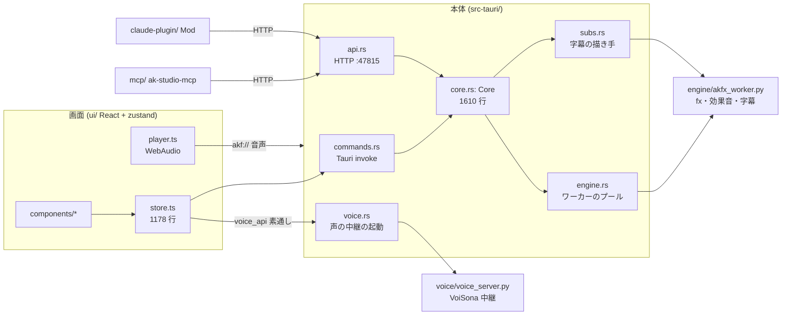

# AK Studio の構成と責務の整理

調べた日: 2026-10-20、main `b90b0dc`。
更新: 2026-10-23、main `d440dcb`（旧#140）。段 1〜5 と独立の行はすべて済んだ。2 節の木を今のフォルダに合わせ、3 節に済んだ日と PR・その後の作業を足した。
目的: いまの要素の関係を 1 枚にまとめ、責務（だれが何の「正」を持つか）で置き場所を決め直す。
参考にした open issue（2026-10-20 の時点）: 旧#26・旧#27・旧#28・旧#33・旧#34・旧#35・旧#36・旧#74・旧#83。
監査の指摘のうち、置き場所の問題に帰着するものもここで扱う。

この文書は 2 部:

1. **段 1 の前の構成**（2026-10-20 の記録。コードの行つき。**行番号は段1 の前の `b90b0dc` の時点**。段1 の後のどこへ移ったかは、控えの記録の表）。
   ここに書いた問題はほぼ片づいたので、**今の構成は 2 節を見る**
2. **目標の置き場所と移し方**（2.2・2.3 の木は今のフォルダ。目標から外れたもの・まだのものはその場に注記）

---

## 1. 段 1 の前の構成（2026-10-20 の記録）

この節は書いた時点の事実のまま残す（ファイル名・行数・行番号は `b90b0dc` のもの）。

### 1.1 プロセスと通り道



入口が 2 つ（`commands.rs` と `api.rs`）あり、どちらも `Core` のメソッドを呼ぶ。画面の型は `ui/src/types.ts` に手で写している（旧#27）。

### 1.2 Rust のモジュールの依存（`crate::` の参照から）

| モジュール | 行数 | 依存先 | 役目 |
|---|---:|---|---|
| `core.rs` | 1610 | agent cache engine media msg project script scriptops settings subs trans voice | 回の状態・合成・先読み・微調整・見張り・推敲案の採否（**何でも屋**） |
| `script.rs` | 1715 | settings | 台本の書式（md/yaml）＋ ScriptStore（読み書き・外の変更とのマージ・移行） |
| `export.rs` | 1135 | cache core engine media msg rekey scriptops settings subs | talk の書き出し＋キーの付け替え・映像・効果音・ミックス・字幕・録画トラック |
| `engine.rs` | 961 | msg settings | Python ワーカーのプール（急ぎ・後回し） |
| `settings.rs` | 823 | — | 設定＋埋め込みファイルの書き出し＋Python/ffmpeg の解決＋MCP の登録 |
| `project.rs` | 709 | settings subs | `project.json`（素材・ネスト・字幕の見た目）の型と読み書き |
| `subs.rs` | 658 | core(VoiceItem) engine media project settings | 字幕の見た目の解決・区間・描き手（専用ワーカー） |
| `agent.rs` | 647 | settings | チャット・推敲案・届け方（Hub） |
| `api.rs` | 616 | agent cache core engine export mediaops msg project scriptops sebank settings | Claude 用 HTTP |
| `commands.rs` | 551 | ほぼ全部 | Tauri コマンド |
| `media.rs` / `mediaops.rs` | 511 / 489 | settings / cache core media project script | 素材のデコード / 素材トラックの操作（MCP の media_*） |
| `rekey.rs` | 412 | — | cue のずれの付け替え（純粋） |
| `trans.rs` | 294 | project | 入り・抜けの動き（純粋） |
| `sebank.rs` | 243 | core export msg settings | 効果音の候補表 |
| `scriptops.rs` | 182 | agent core(VoiceItem) script | 推敲案の適用 |
| `voice.rs` | 161 | settings | voice_server.py の起動と HTTP の素通し |

気になる向き:

- `VoiceItem`（セリフの並び）が `core.rs:24` に定義され、`subs`・`scriptops`・`export` がそれを取りに `core` を見る。並びは本来「声」の領分。
- `export`・`sebank`・`syncman`・`mediaops` は `&Core` を丸ごと受け取る。何を読むか・書くかが型から分からない。
- `Core` のフィールド（`core.rs:63-91`）: 設定・エンジン・素材・キャッシュ・Hub・声・字幕・回の状態・**`ui: Value`**・**`layout: Vec<VoiceItem>`**・書き出しの警告・見張り・自分の書き込み・微調整のロック・API のポート・見比べ・fx のエラー。

### 1.3 「正」はどこにあるか（状態の持ち主）

| データ | 正の持ち主 | 写し・別計算 | 関係する issue |
|---|---|---|---|
| 台本（yaml） | Rust `ScriptStore` | 画面 `store.script`（自動保存で書き戻す） | — |
| 声の解析（長さ・音素） | **画面** `store.analysis`（`store.ts:599 lookupAll`） | Rust は `voice_api` で素通し（`commands.rs:105`） | 旧#26 |
| セリフの並び（layout） | **画面** `voice.ts:91 layoutLines` → `set_layout`（`commands.rs:132`） | Rust `core.layout` は受け取るだけ | **旧#26**（ST-4） |
| 声のキャッシュの鍵 | 画面 `voice.ts:8 vkey`・Rust `script.rs:118 vkey`・Python | 3 か所 | 旧#28 DU-7 |
| 字幕の見た目の既定・解決 | `ui/src/subs.ts:7`・`subs.rs:61,206`・`akfx_worker.py` | 3 か所 | 旧#28 DU-6 |
| 「画面の状況」の文 | `mcp/src/main.rs:332`・`register.tsx:49`・ほか | 5 か所 | 旧#28 DU-2 |
| 画面の状態（再生位置・選択） | 画面 → `set_ui` → `core.ui: Value` | 型なし | 旧#36 ST-13 |
| 微調整（overrides） | Rust（`core.rs:434 patch_override`） | 画面が先に反映（`store.ts:841`） | 旧#36 ST-9 |
| `project.json` | Rust `PState` | 外の変更は見張らない（Claude は `media_*` を通す）。保存前の確認も無い | 旧#34 |
| 演出の描画の準備ぐあい | Rust `cache.rs`（`cached_ranges`） | 画面は再生時に見ない | 旧#83 |
| 効果音の wav | Python（モニターと同じワーカー、`export.rs:600`） | — | 旧#33 |

**いちばん大きなずれは「声」の領域**: 解析・並び・鍵の判断が画面にあり、Rust は中継だけ。
このため Claude（HTTP 経由）の操作の直後に Rust 側で並びを使う処理（書き出し・字幕・`speaking_at`）が古い値を見る（旧#26）。
再生で「まだ準備できていない区間」を判断する材料も画面と Rust に割れている（旧#83）。

### 1.4 画面（ui/src）

- `store.ts`（1178 行）に、履歴（undo/外の変更）・自動保存・layout・声の解析と作成・微調整・`project.json` の編集・チャット・初期化がすべて入っている。
- 純粋な関数（`voice.ts`・`nestcalc.ts`・`history.ts`・`trans.ts` など 30 ファイル）は平らに並び、テストは `ui/test/` にある。良い形なので保つ。
- ただし `media.ts`・`nest.ts`・`subs.ts`・`player.ts` は `store` を import していて純粋ではない（I/O と計算が混ざっている）。
- `drift.tsx` は部品なのに `components/` の外にある。

### 1.5 Python

- `engine/akfx_worker.py`（1502 行）: fx の読み込みとコマ・効果音（bank・書き出し・試聴）・画面で足した演出・字幕・フォント。1 つのプロセスの種類に 4 つの仕事。
- `fxkit/`・`voice/` は役目が分かれていて問題は小さい。

---

## 2. 目標の置き場所

### 2.1 方針

1. **層を一方向にする**: 入口（Tauri・HTTP）→ 回のサービス（`Core`）→ 領域のロジック（純粋）→ 下回り（ワーカー・ファイル・設定）。
   領域のロジックは `&Core` を受け取らず、必要なデータを引数で受ける（テストしやすく、何を触るか分かる）。
2. **1 つの決まりは 1 か所で計算する**。言語をまたぐときは「Rust が計算して結果を配る」を基本にし、
   どうしても両方で要るもの（再生中の即時の反応など）は同じ入力を当てるテストで縛る。
3. **入口は薄く**。`commands.rs` と `api.rs` は引数の変換だけにして、同じ処理は同じ `Core` のメソッドと同じ型（DTO）を通す（TY-13・DU-12）。
4. **ファイルは小さく、領域ごとのフォルダに**。`impl Core` は複数ファイルに分けられるので、まず動きを変えずに割る。

### 2.2 Rust（`src-tauri/src/`）

2026-10-23（`d440dcb`）の今のフォルダ。括弧の `core.rs:…` などは、段 1〜3 でどこから移したか。中身の短い `mod.rs`（script・voice・render）は略した。

```
lib.rs  main.rs      akf:// のスキーム・起動
app/                 入口（薄く）
  mod.rs             入口の共通（コマンドとイベントの名前の表のテスト）
  commands.rs        Tauri コマンド
  api.rs             Claude 用 HTTP
  dto.rs             画面に返す形（Snapshot・ClaudeInfo・EngineInfo・画面の状態 UiState。ts-rs で ui/src/gen/ の型になる）。入口をまたぐ型（画面と HTTP で共通の Scene・MediaProbe・SeBankUpdate、HTTP の要求と MCP の引数）は crates/ak-proto に置く
  error.rs           失敗をコードつきで持つ {code, message}（旧#35 UX-2）
  rules_fixture.rs   画面に残した Rust の決まりの写しを tests/fixtures/ui_rules.json で縛る（旧#101）
core/                回のサービス（Core = 状態の持ち主と調停役）
  mod.rs             Core の定義・open・snapshot・emit
  overrides.rs       微調整のマージ・clean・nest_flags（core.rs:402-550, 1339-1450）
  watch.rs           ファイルの見張り（core.rs:1140-1334）。project.json は見張らない（旧#34 は project.rs の保存前の確認）
  compose.rs         合成・コマ・静止画・先読み（core.rs:601-1029）
  proposals.rs       推敲案の採否（core.rs:1454-）
  voice.rs           声の解析と並びを持ち、変わったら refresh_voice で並べ直して配る（段 3）
  marks.rs           モニターの印（studio/marks.json）
  guide.rs           攻略動画（guide.json）の読み書き・見張り・合成（draw_guide）・解析の実行
  guide_audio.rs     攻略動画の素材の音・効果音の作り直し
script/
  format.rs          md/yaml の書式（script.rs:102-441）
  store.rs           ScriptStore（script.rs:444-1053）
  ops.rs             ← scriptops.rs
  rekey.rs           ← rekey.rs
voice/               声の領域（旧#26 で画面から移した。段 3）
  relay.rs           ← voice.rs（中継の起動・HTTP）
  analysis.rs        解析のキャッシュ・署名（sigOf/isFresh）・lookup・作成の順番待ち
  layout.rs          VoiceItem と並びの計算（voice.ts:91 layoutLines を移植。core.rs:24 の VoiceItem もここへ）
  key.rs             vkey・tts_text・sub_text（script.rs:102-133 から）
render/              描く下回り
  engine.rs  cache.rs  media.rs
  trans.rs  ease.rs  入り・抜けの動き・緩急（Rust が正。fxkit は見本で縛る、旧#100）
  subs.rs            字幕の解決はここだけ（旧#28 DU-6）。画面には解決済みの見た目を配る
  scenes.rs          シーン番号（Rust だけが決める、旧#97）
  ready.rs           再生の前の「準備できていない区間」（段 4、旧#83）
  sheet.rs  syncrep.rs   render_sheet の並べ方・sync_report の一覧
export/
  mod.rs             run・進み具合・中止
  talk.rs            script.srt などと付け替え（export.rs:123-345）
  video.rs           overlay・mp4・rec_track（TempEngine を含む）
  audio.rs           mixdown・効果音（旧#33: TempEngine で作る）・攻略動画の素材の音
  subs.rs            字幕の書き出し
guide/               攻略動画の純粋な部分
  mod.rs             全体の説明と guide.json・guide_analysis.json・guide_map.json の型
  plan.rs  layer.rs  map.rs  patch.rs  read.rs  still.rs  undo.rs  audio.rs
  fx_stub.py         攻略動画の回の fx/guide_fx.py のひな形
project.rs  mediaops.rs  sebank.rs  syncman.rs  agent.rs  chatimg.rs
msg.rs               何か所からも使う文言
settings/
  mod.rs             設定の読み書き
  embed.rs           埋め込みファイル（FXKIT_FILES・VOICE_FILES）
  tools.rs           Python・ffmpeg の解決、MCP・フックの登録
```

目標から外れたもの:

- `app/context.rs` は作らなかった。「画面の状況」の文は `agent.rs` が作る（`situation` を、チャットの本文は `prompt_text`、帯とフックは `status_line` → `/api/status` の `situation` が使う）。MCP・Mod は受け取るだけ（旧#28 DU-2）。画面の状態の型 `UiState` は `app/dto.rs`
- `error.rs` は `app/error.rs` に置いた。`msg.rs` は文言の置き場所として残っている

`Core` に残すもの: 回の状態（`PState`）・各部品のハンドル・emit・調停（ロック）。
`Core` から出したもの: `ui: Value` は型つきの `UiState` に（ST-13）、並びの計算は `voice/` へ。

### 2.3 画面（`ui/src/`）

2026-10-23（`d440dcb`）の今のフォルダ。

```
main.tsx  App.tsx  styles.css
types.ts       手で書いた型の残り（効果音の設定 SeBank など。旧#142 で ak-proto へ移す予定）
gen/           ts-rs が書き出す型（手で直さない）
io/            外とのやり取り（store を import してよい）
  api.ts  commands.ts  player.ts  notify.ts
state/         zustand（useS は store.ts の 1 つ。各 slice は別ファイルで useS.setState を呼ぶ。部品は index.ts から import）
  index.ts     init（本体からの知らせの購読）・再エクスポート
  store.ts     useS（型・初期値）・トースト
  history.ts   undo/redo・見比べ・外の変更（store.ts:216-414）
  script.ts    台本の保存・editScript・並びの受け取り・台本 → 演出の入力の書き出し（store.ts:418-480）
  voice.ts     声（解析・音声の作成・一括作成）。並びと解析の結果は Rust から受け取る
  project.ts   微調整・editDoc・回の読み込み・効果音の設定
  chat.ts      選択・Claude への文脈・チャット・画面の状態（UiState）を本体へ送る購読
  media.ts  nest.ts  subs.ts   素材トラック・RecWindow のネスト・字幕の見た目の操作（計算は logic/）
  marks.ts  guide.ts           モニターの印・攻略動画（どちらも持ち主は Rust）
logic/         純粋な関数（ui/test が対象）。文言の表 terms.ts・失敗の文 errors.ts もここ（旧#35 UX-1・UX-2）
components/    drift.tsx もここ。guide/ は攻略タブの部品
```

- `logic/` は `state/`・`io/` を import しない（`ui/test/layers.test.ts` で縛っている）。`media.ts`・`nest.ts`・`subs.ts` は計算部分を `logic/` に、呼び出しを `state/` に分けた。
- 旧#26 で `voice.ts` の `layoutLines`・`sigOf`・`isFresh` は Rust に移り（`core/voice.rs` の `refresh_voice`）、画面は並びを受け取る。
- 画面に残した Rust の決まりの写し（区間・ネスト・トランジションなど）は、見本の表 `src-tauri/tests/fixtures/ui_rules.json` で Rust と縛っている（`app/rules_fixture.rs` が作り、`ui/test/rules.test.ts` が読む。旧#101）。
- 目標から外れたもの: `strings.ts` は作らず、文言の表は `logic/terms.ts`（2 か所以上に出る語と値に結びつく名前だけ。用語集の禁止語は `ui/test/terms.test.ts` で縛る）。

### 2.4 Python（`engine/`）

**まだ（2026-10-23）**。`akfx_worker.py` は 1 ファイルのまま（1696 行）。効果音の設定の部分は 旧#142 で境界を型で縛るときに一緒に考える。種類の表示名は 旧#36（DU-13）で済み。

`akfx_worker.py` を、ワーカーの入口（読み書き・`op` の振り分け）と仕事ごとのモジュールに割る:
`worker_fx.py`（fx の読み込み・コマ）・`worker_se.py`（効果音）・`worker_subs.py`（字幕・フォント）・`worker_gui.py`（画面で足した演出）。
埋め込みの表（`settings/embed.rs`）にも足す。効果音の種類の表示名（今は `akfx_worker.py` の `se_bank_info` が返す）も `worker_se.py` に移す。

### 2.5 MCP・Mod

- ツールの引数の型は `crates/ak-proto/src/http.rs` に置き、HTTP の要求（serde）と MCP の `inputSchema`（schemars。`mcp/src/main.rs` の `tools()`）を同じ型から作る（旧#27 DU-10）。説明文は各項目の `///` の doc コメント。引数が構造体でないツール（`clip_adjust`・`media_add` など）は手書きのまま。
- 画面の型は `cargo test` が `ui/src/gen/` に書き出す（ts-rs。コミットする）。コマンドとイベントの対応表は `ui/src/io/commands.ts`（漏れは `app/mod.rs` のテストが見つける）。
- 「画面の状況」の文は本体（`agent.rs`）が作り、MCP と Mod は受け取って貼るだけ（旧#28 DU-2、済み）。
- session.json が残っているとき（本体が落ちた）は、MCP の接続失敗の文で知らせる（旧#36 DU-14、済み）。pid の確認は Windows の依存が要るのでしない。Mod はつながらなければ帯を出さないだけ。

### 2.6 Python と Rust の境界

決まり: **演出のコード（`fx/*.py`）を書き換えると変わるものは Python、変わらないものは Rust**。
演出はその場で書き換えて保存だけで読み直す（Claude が書く）ので、演出の中身は Python から動かさない。

| Python（`engine/`・`fxkit/`） | Rust（`src-tauri/`） |
|---|---|
| 演出の中身: `fx/<名前>_fx.py`・fxkit・fxparts | セリフの並び（layout）・声の解析（段 3、済み） |
| クリップの一覧・時刻・bbox・効果音のきっかけ（`describe()`）と、そのコマの絵 | 微調整のマージ・合成・キャッシュ・再生の準備ぐあい |
| PIL で文字を描くこと（字幕の絵・フォント） | 字幕の見た目の解決（段 5、済み） |
| 効果音の bank・書き出し | 素材トラック（立ち絵・画像・録画・BGM）の描画と入り・抜け（`render/trans.rs`） |

データは一方向に流れる:

```
台本 → [Rust] 声の解析・並び → files/script_cues.json ─┐
                                                 ├→ [Python] 演出のコマ → [Rust] 合成・キャッシュ・書き出し
             fx/*.py（その場で書き換える）───────┘
```

演出は `script_cues.json`（`script.srt` と同じ並びから Rust が書く cue の表）を読んでセリフに合わせるので、その並びは上流の Rust に置く（旧#26 を Rust に移す理由の 1 つ）。

**両方に同じ式があるもの**（CLAUDE.md「fxkit 側と同じ結果になるように合わせてある」）は、2 種類に分けて扱う:

| 式 | 種類 | 扱い |
|---|---|---|
| シーン番号の決め方 | **ずれると壊れる**（Claude に伝えるシーン番号・仮表示つき .mov の札が食い違う） | Rust だけで決める（`render/scenes.rs`、旧#97）。ワーカーは札の絵を描くだけ。fxkit の `Timeline.scenes` と fxcli は 旧#98 で消した |
| srt の読み方（`script/rekey.rs srt_lines` ⇔ fxkit の `parse_srt`） | **ずれると壊れる**（cue の時刻が演出と食い違う） | studio が `files/script_cues.json` を書き、fxkit はそれだけを読む。`parse_srt` は消した（旧#99、型は ak-proto の `CueTable`）。`sync_manual.json` の 1 件も ak-proto の `SyncPoint` |
| 素材の入り・抜け（`trans.rs` ⇔ fxkit の `Sprite` の `enter`・`glitch`） | **意図的にそろえているだけ**（別のものを描いていて、ずれても見た目が少し不揃いになるだけ） | 二重持ちのままでよい。そろえたいなら、同じ `enter` と進み具合を当てて移動量と濃さが合うかをテストで縛る（任意） |
| 字幕の既定の見た目 | ずれると壊れる（画面の表示と書き出しが違う） | Rust を正にした（段 5、旧#28 DU-6）。Python は渡された見た目で描くだけ |

`Sprite`（`fxkit.py:355`）は、PIL の絵 1 枚を入り・抜けの動きつきで置く演出の土台の部品で、`fxparts.py` の部品のほとんどはこれで出している。
`render/trans.rs` はそれと見た目をそろえた、素材トラックのクリップ 1 つずつの入り・抜け（`core/compose.rs:157 draw_clip`）。完成した映像全体には掛けていない。

### 2.7 素材のエフェクトの拡張（段 6、旧#86）

いまは素材（立ち絵・画像・録画）に新しい種類の動きを足すには `render/trans.rs` を書き換えてビルドし直す必要があり、Claude がその場で作れない。
足したいものを 3 つに分け、ビルドしないで済む作りを ①・② の順に入れる:

| 足したいもの | 例 | 作り方 |
|---|---|---|
| ① 既存の動きの組み合わせ・強さ・タイミング | グリッチを強めに 0.5 秒、揺らしながらフェード | エフェクトをデータ（キーフレームの JSON）にして `project.json` のクリップ（いまの `trans_in` / `trans_out` の場所）に持つ。Rust は部品だけ持ち、Claude は `media_update` で書く |
| ② 新しい動きの曲線 | 独自の弾み方、ランダムな揺れ | `fx/` の Python に「動きの関数」を書き、ワーカーが**各コマの数値**（位置・倍率・濃さ・グリッチの量）を返して Rust がその数値で描く。画素は渡さないので速く、演出のコードと同じく保存だけで読み直す |
| ③ 新しい画素の加工 | 色収差、歪み、モザイク | 必要になってから考える。シェーダー（実行時に読む WGSL など）なら速いが合成を GPU に載せ替える大きな組み替え。Python に画素を渡すのは 1920×1080 を毎コマ往復するので遅い |

① と ② で入り・抜け・揺れ・強調のほとんどは表せる。画素の処理は Rust に残るので、プレビューの速さを落とさない。

---

## 3. issue との対応と順番

| 段 | 内容 | 動きの変化 | 片づく issue |
|---|---|---|---|
| **0** | この文書 | なし | — |
| **1（済み）** | 動きを変えない分割（2026-10-20、PR 旧#87）: `core.rs`・`script.rs`・`export.rs`・`settings.rs` をフォルダに、`store.ts` を slice に、`ui/src` を `logic/ io/ state/` に | なし（テストがそのまま通ること） | 後の作業の前提 |
| **2（済み）** | （2026-10-20、PR 旧#90）入口の共通化: `app/dto.rs`・シーン一覧と時刻の決まりを 1 つに、型の生成（`ts-rs`＋`schemars`） | 返す形がそろう | 旧#27、旧#36 TY-10/12/13・DU-12 |
| **3（済み）** | （2026-10-20）声の領域を Rust へ: 解析のキャッシュ・並び・鍵 | Claude の操作の直後の書き出しが正しくなる | **旧#26**、旧#28 DU-7 |
| **4（済み）** | （2026-10-20）再生の待ち: Rust が「準備できた区間」（声の音声・演出のコマ・字幕）をまとめて返し、`player.ts` が未準備の手前で止まって待つ | 再生が待つ | **旧#83**（段 3 の後が楽。並びと声の準備を Rust が知るため） |
| **5（済み）** | （2026-10-20、PR 旧#96）字幕の解決を Rust だけに、「画面の状況」の文を本体に | 見た目の決まりが 1 つに | 旧#28 DU-6・DU-2・DU-7 |
| 独立（済み） | （2026-10-20、PR 旧#95）効果音の書き出しを TempEngine で | 書き出し中もモニターが動く | 旧#33 |
| 独立（済み） | （2026-10-20、PR 旧#93）`project.json`・`fx/se/bank.json` の保存前に指紋を比べ、外で変わっていたら控えを残す（`project.rs`。見張り・読み直しはしない） | 外の変更が黙って消えない | 旧#34 |
| 独立（済み） | （2026-10-21、PR 旧#111・旧#112・旧#113）`app/error.rs` の `{code, message}`・文言の表 `logic/terms.ts` | 画面のエラーの文 | 旧#35 |
| 独立（済み） | （2026-10-21、PR 旧#107）字幕の文の確定のタイミング（画面だけ。判断を `logic/` の関数に） | 編集中のプレビュー | 旧#74 |
| **6** | 素材のエフェクトの拡張（2.7 節）: ① エフェクトをデータに → ② Python の「動きの関数」 | 素材の動きを AI がビルドなしで足せる | 旧#86（まだ） |

段 1 は大きいが機械的で、ファイルが重なるので **1 本ずつ順に**（並行にしない）。独立の行は段 1 の後ならいつでも並行に出せる。

### 3.1 その後の作業（2026-10-20 〜 10-23）

| 内容 | issue・PR | 文書 |
|---|---|---|
| 名残の写しの整理: シーン番号を Rust だけに・fxcli の確認の道を消す・cue の表を studio から渡す・入り・抜けの式を Rust に・画面の写しを見本で縛る | 旧#97〜旧#101（PR 旧#102〜旧#106） | — |
| 監査の低の項目（19 件） | 旧#36（PR 旧#108〜旧#110） | — |
| 攻略動画（`guide/`・`core/guide.rs`） | 段 1〜5（PR 旧#115〜旧#119）と手直し（PR 旧#120〜） | — |
| ak 系のスキルをプラグインへ | PR 旧#136 | — |

### 3.2 残っているもの（2026-10-23）

- 機能: 旧#86（段 6）・旧#134（攻略動画のサムネ）
- 技術的負債: 計画は 旧#145。旧#137（台本の控え）は済み（PR 旧#146）。残りは 旧#138（CI）・旧#139（芯のテスト）・旧#141（微調整の送信の失敗）・旧#142（効果音の設定の型。2.4 節）・旧#143（画面の大きい部品）・旧#144（依存の版）

---

## 4. 決めたこと（2026-10-20、ユーザーの回答）

1. **段 1 はフォルダに組み替える**（`git mv`。Rust は `app/ core/ script/ voice/ render/ export/ settings/`、画面は `logic/ io/ state/`）。
2. **旧#26 は解析ごと Rust に持たせる**（解析のキャッシュ・署名・並び・鍵を `voice/` へ。画面は結果を受け取る）。
3. **旧#27 の型は `ts-rs`＋`schemars`**（ドメインの型と `app/dto.rs` は ts-rs で `ui/src/gen/` に、入口をまたぐ型と HTTP の要求は `crates/ak-proto` に置いて TS の型と MCP の JSON Schema を生成。コマンド名は `io/commands.ts` の対応表で縛る）。
